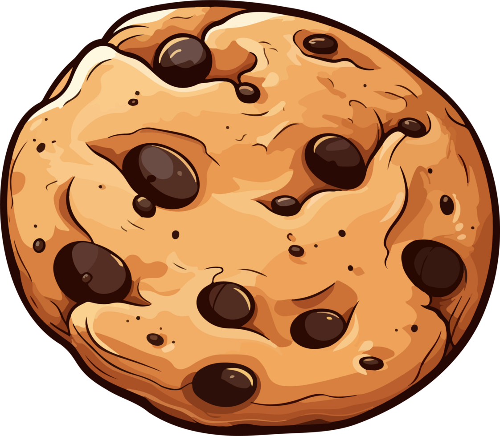

# Reacta assignment 2: useState() and useEffect()

- Due _*22.10.26 by*_ 11:59pm

Canvas link - assigment text:
"https://jobloop.instructure.com/courses/557/assignments/11970"

In this task you will make 3 React-components to get practice in using **React Hooks** such as `useState`and `useEffect`. You will handle state, fetch data from API's and build interactive interfaces.

The assignment is divided into 3 segments:

1. **CookieClicker**: Make a button(Cookie) that gives the user point for each click.
2. **CatFacts**: Fetch and display fact about cats from an API.
3. **Users**: Display a list of users with the possibility to add new users.

Solve the assignment task by task and have fun while you code! 😊
Jump to [CookieClicker](#cookieclicker-component).
Jump to [CatFacts](#catsfacts-component)
Jump to [Users](#user-component)

## My thoughts and plan:

- Have many questions about parts of this task that needs answers before I know what I need to do, f.ex in CatFacts it first says to fetch a random fact, at the end it says to display them all, am I supposed to do both in a clever way or is this just a typo of some sort?
- Priority: figure out how to get React to complete the actions I want it to run via functions and components. [x] (needed help)
- Then fix styling, this because everything broke when I attempted to use module css... [..] Better, but still...
- Fix css animations, add module css to each component -> make them into cards? []
- cleanup comments and not needed code. []
- Possible solution to my conundrum on catFacts: just do both. Make it display a random catFact when the page loads, wrap the <p> in a button or a div and make it obvious that it can be clicked: when clicked it loads all catFacts available via the API. []

## CookieClicker Component

**Goal**: Create a component where you can click a Cookie(button) to achieve points.

Example of a button:

```<button>
    
</button>
```

-- Image of the cookie was here on the page -> can be found in the public folder as cookie.png --
Tip: cookie.png must be stored in public/.

### Utility:

- When the user click the button(Cookie), they get a point per click.
- Use `useState` to keep overview of the point collection/score.

### Points display:

- Display the points on the screen, letting the user see how many points they've collected

## CatsFacts-component

**Goal**: Create a component that fetches random CatFacts from an API and displays them on the screen.
**API**: Use this API to fetch the data: "https://catfact.ninja/facts?limit=5"

### Utility:

1. **Fetch Data**:
   - Use `useEffect` to fetch data when the components mounts.
2. **Manage states**:
   - Use `useState` to manage these three states:
     - **loading**: Display "Loading..." while data is being fetched.
     - **error**: Display an error statement if there is an error during the API-query.
     - **facts**: Display facts about cats after the data is fetched.
3. **Presentasjon**:
   - When the data is fetched, display all the Cats Facts on screen.
   - Use `.map()` to loop through the facts.

## User-component

**Goal**: Create a component that displays a liste of users. Use the `mockData` below as your basis.
This data set is your foundation:

```const mockData = [
    { username: 'Ola Normann', email: 'ola.normann@norge.no'},
    { username: 'Torleif', email: 'torleif@kodehode.no' },
    { username: 'Jan Egil', email: 'jan.egil@kodehode.no' },
    { username: 'Sander', email: 'sander@kodehode.no' },
]
```

$${\\color{red}Note: \\space You \\space will \\space only \\space manage \\space data \\space stored \\space with \\space and \\space in \\space useState, \\space meaning \\space do \\space not \\space edit \\space or \\space modify \\space the \\space mockData.}$$

### Utility:

1. **Display of users**:
   - Start by displaying the list of users (from the mockData) on screen.
2. **Adding new users**:
   - Create to input fields:
     - One for **username**.
     - One for **email**.
   - Create a button that adds a new user to the list when it is clicked.
3. **Use of useState**:
   - Use `useState` to manage the list of users.
   - When the user adds text in the input fields and click the button, the new user will be added to the list.

**Assessment**:

- Users should be able to add new users by filling the input fields and pressing the button.
- The new user will then be added and displayed to the list after the button is clicked.
